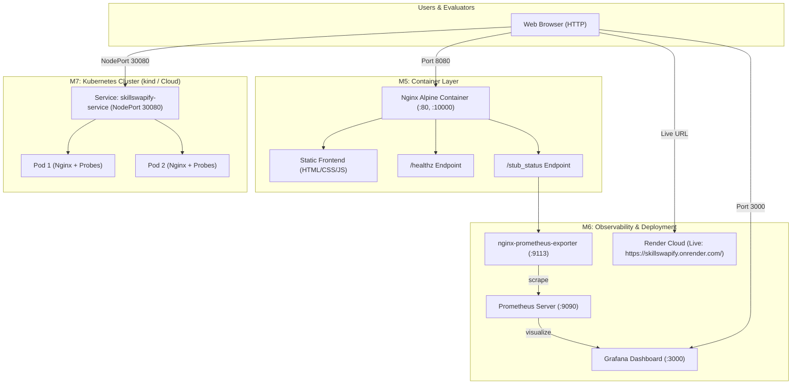
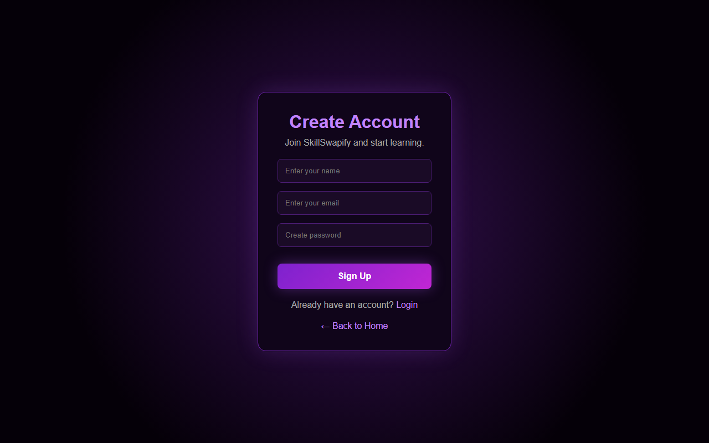
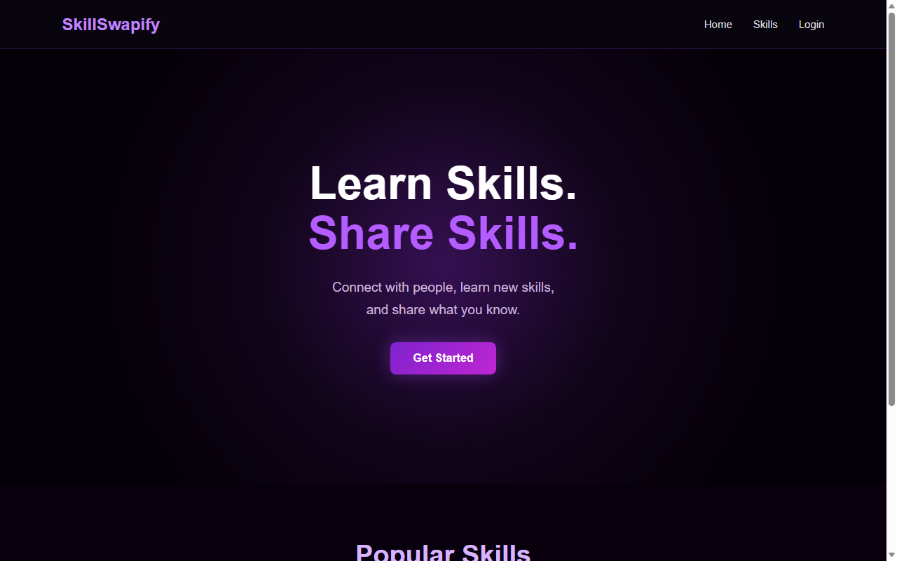

# SkillSwapify — DevOps Practices and Principles (CSUL511) MT2

**SkillSwapify** is a web-based skill-sharing platform built with standard HTML, CSS, and modern JavaScript. This repository contains the complete DevOps implementation for **Milestone 5 (Docker)**, **Milestone 6 (Deployment & Monitoring)**, and **Milestone 7 (Kubernetes)**.

- **Live Deployed Application (Render)**: [https://skillswapify.onrender.com/](https://skillswapify.onrender.com/)
- **Live Health Endpoint**: [https://skillswapify.onrender.com/healthz](https://skillswapify.onrender.com/healthz)

---

## 📑 Table of Contents
1. [Architecture Overview](#-architecture-overview)
2. [Project Structure](#-project-structure)
3. [M5 — Docker Containerization](#-m5--docker-containerization)
   - [Dockerfile & Optimization](#dockerfile--optimization)
   - [Local Docker Build & Run](#local-docker-build--run)
   - [Docker Compose](#docker-compose-setup)
   - [Verification](#verifying-the-docker-container)
   - [Docker Hub Publishing Instructions](#publishing-to-docker-hub)
4. [M6 — Cloud Deployment & Monitoring](#-m6--cloud-deployment--monitoring)
   - [Cloud Deployment on Render (Public URL)](#cloud-deployment-on-render)
   - [Health Endpoint (`/healthz`)](#health-endpoint)
   - [Prometheus Metrics Setup](#prometheus-metrics-setup)
   - [Grafana Dashboard](#grafana-dashboard)
   - [Full Local Monitoring Stack](#running-the-local-monitoring-stack)
5. [📸 Deployment & Verification Screenshots](#-deployment--verification-screenshots)
6. [M7 — Kubernetes Orchestration](#-m7--kubernetes-orchestration)
   - [Kubernetes Architecture & Manifests](#kubernetes-architecture--manifests)
   - [Resource Limits & Health Probes](#resource-limits--health-probes)
   - [Running with `kind`](#running-with-kind)
   - [Deployment & Verification Commands](#deploying-and-verifying-pods--services)
7. [Deliverables & Checklist Summary](#-deliverables--checklist-summary)

---

## 🏛 Architecture Overview



---

## 📁 Project Structure

```text
devops-24ESKCS113/
├── .dockerignore                            # Excludes git, docs, and configs from Docker build context
├── .git/                                    # Git repository
├── 50x.html                                 # Clean server error page for Nginx
├── Dockerfile                               # Production-ready Nginx Alpine container definition
├── docker-compose.yml                       # Multi-service stack (Web + Exporter + Prometheus + Grafana)
├── healthz                                  # Static health check fallback
├── index.html                               # SkillSwapify landing page
├── nginx.conf                               # Nginx configuration (gzip, security headers, health, stub_status)
├── render.yaml                              # Infrastructure as Code blueprint for Render deployment
├── script.js                                # Frontend client scripts
├── signup.html                              # User account creation page
├── style.css                                # Application stylesheet
├── k8s/                                     # Kubernetes manifests (Milestone 7)
│   ├── deployment.yaml                      # Kubernetes Deployment (2 replicas, probes, resource limits)
│   ├── kind-config.yaml                     # kind cluster config with port mappings
│   └── service.yaml                         # Kubernetes NodePort Service
├── monitoring/                              # Observability stack (Milestone 6)
│   ├── prometheus.yml                       # Prometheus scraping configuration
│   └── grafana/
│       ├── dashboards/
│       │   └── skillswapify-dashboard.json  # Reusable Grafana dashboard JSON
│       └── provisioning/                    # Auto-provisioning configurations
│           ├── dashboards/
│           │   └── dashboard.yml
│           └── datasources/
│               └── datasource.yml
├── screenshots/                             # Live deployment and verification captures
│   ├── render-live-deployment.png           # Live Render landing page
│   ├── render-live-signup.png               # Live Render sign-up page
│   ├── docker-local-web.png                 # Local containerized home page
│   └── docker-local-signup.png              # Local containerized sign-up page
└── README.md                                # Comprehensive DevOps guide & documentation
```

---

## 🐳 M5 — Docker Containerization

### Dockerfile & Optimization
The application is packaged using `nginx:1.27-alpine`:
- **Lightweight & Secure**: Alpine Linux base ensures minimal image size (~25-45 MB) and reduced attack surface.
- **Production Nginx Config**: `nginx.conf` enables dual-port listening (80 and 10000 for cloud compatibility), gzip compression, security headers (`X-Frame-Options`, `X-Content-Type-Options`), asset caching, and route handling.
- **Dedicated Healthcheck**: A built-in container `HEALTHCHECK` periodically verifies `http://localhost:80/healthz`.

### Local Docker Build & Run
To build and run the image manually with Docker CLI:

```bash
# 1. Build the Docker image with registry tag
docker build -t dineshkumar2908/skillswapify:latest .

# 2. Run the container on port 8080
docker run -d --name skillswapify-app -p 8080:80 dineshkumar2908/skillswapify:latest

# 3. View running container status
docker ps -f name=skillswapify-app
```

### Docker Compose Setup
Run the containerized web app using Docker Compose:

```bash
# Start only the web service in the background
docker compose up -d web

# Stop the service
docker compose down
```

### Verifying the Docker Container
Once running, verify functionality using a web browser or curl:
- **Application Homepage**: Open [http://localhost:8080](http://localhost:8080)
- **Sign Up Page**: Open [http://localhost:8080/signup.html](http://localhost:8080/signup.html)
- **Health Check**: Run `curl -i http://localhost:8080/healthz` (returns HTTP `200 OK` with body `OK`)
- **Container Health Status**:
  ```bash
  docker inspect --format='{{json .State.Health.Status}}' skillswapify-web
  ```

### Publishing to Docker Hub
Follow these steps to publish your image to your Docker Hub registry:

```bash
# 1. Log in to Docker Hub (enter your Docker Hub username and password/token)
docker login

# 2. Tag your local image
docker tag dineshkumar2908/skillswapify:latest dineshkumar2908/skillswapify:v1.0.0
docker tag dineshkumar2908/skillswapify:latest dineshkumar2908/skillswapify:latest

# 3. Push both versioned and latest tags to Docker Hub
docker push dineshkumar2908/skillswapify:v1.0.0
docker push dineshkumar2908/skillswapify:latest

# 4. Public image URL:
# https://hub.docker.com/r/dineshkumar2908/skillswapify
```

---

## 📈 M6 — Cloud Deployment & Monitoring

### Cloud Deployment on Render
SkillSwapify is live and publicly accessible:
- **Live Public URL**: [https://skillswapify.onrender.com/](https://skillswapify.onrender.com/)
- **Live Health Endpoint**: [https://skillswapify.onrender.com/healthz](https://skillswapify.onrender.com/healthz)

#### Method 1: Automatic Blueprint Deployment (Recommended)
1. Commit and push the repository to GitHub: `git push origin main`.
2. Go to [https://dashboard.render.com](https://dashboard.render.com).
3. Click **New +** and select **Blueprint**.
4. Connect repository `devops-24ESKCS113`.
5. Render detects [render.yaml](file:///C:/Users/hp/Desktop/devops-24ESKCS113/render.yaml) automatically.
6. Click **Apply**. Render deploys the static site to its global edge CDN and assigns the live URL: `https://skillswapify.onrender.com/`.

#### Method 2: Manual Web Service / Static Site UI Deployment
1. Log into [Render Dashboard](https://dashboard.render.com).
2. Click **New +** -> **Static Site**.
3. Select **Build and deploy from a Git repository** and connect `devops-24ESKCS113`.
4. Configure:
   - **Name**: `skillswapify`
   - **Branch**: `main`
   - **Build Command**: *(leave empty)*
   - **Publish Directory**: `.`
5. Click **Create Static Site**.
6. Render deploys instantly.

### Health Endpoint
The Nginx configuration provides `/healthz`:
```nginx
location /healthz {
    access_log off;
    default_type text/plain;
    return 200 "OK\n";
}
```
- In addition, a physical static fallback file [healthz](file:///C:/Users/hp/Desktop/devops-24ESKCS113/healthz) is included in the project root to guarantee health check compatibility across CDNs, static web servers, and containerized Nginx.

### Prometheus Metrics Setup
1. **Nginx `stub_status`**: Configured in [nginx.conf](file:///C:/Users/hp/Desktop/devops-24ESKCS113/nginx.conf) at `/stub_status`.
2. **Official Exporter**: The standard container `nginx/nginx-prometheus-exporter:1.3.0` queries `/stub_status` and translates the raw metrics into standard Prometheus metrics on port `9113` at `/metrics`.
3. **Genuine Metrics Exposed**:
   - `nginx_up`: 1 if Nginx is healthy, 0 if unreachable.
   - `nginx_connections_active`: Number of all active client connections.
   - `nginx_connections_reading`: Connections where Nginx is reading request headers.
   - `nginx_connections_writing`: Connections where Nginx is writing responses back to clients.
   - `nginx_connections_waiting`: Idle keep-alive connections.
   - `nginx_connections_accepted`: Total client connections accepted.
   - `nginx_connections_handled`: Total client connections handled without dropped connections.
   - `nginx_http_requests_total`: Total client HTTP requests processed.

### Grafana Dashboard
A production Grafana dashboard has been created in:
- Standalone export: [monitoring/grafana/dashboards/skillswapify-dashboard.json](file:///C:/Users/hp/Desktop/devops-24ESKCS113/monitoring/grafana/dashboards/skillswapify-dashboard.json)
- Auto-provisioning config: [monitoring/grafana/provisioning/dashboards/dashboard.yml](file:///C:/Users/hp/Desktop/devops-24ESKCS113/monitoring/grafana/provisioning/dashboards/dashboard.yml)

**Panels included**:
1. **Nginx Service Status** (`nginx_up` — Stat panel, Green UP / Red DOWN).
2. **Total HTTP Requests** (`nginx_http_requests_total` — Counter panel).
3. **Active Connections** (`nginx_connections_active` — Gauge panel).
4. **Current Request Throughput** (`rate(nginx_http_requests_total[1m])` — Time series).
5. **HTTP Request Rate Over Time** (`rate(nginx_http_requests_total[30s])` — Time series).
6. **Connection States Breakdown** (`nginx_connections_reading`, `writing`, `waiting` — Multi-line time series).
7. **Accepted vs Handled Connections** (`nginx_connections_accepted`, `nginx_connections_handled` — Time series).

### Running the Local Monitoring Stack
To start the entire monitoring stack with a single command:

```bash
# Start Web + Exporter + Prometheus + Grafana
docker compose up -d

# Verify all 4 containers are running healthy
docker compose ps
```

**Port Access Matrix**:
| Service | URL | Default Credentials | Description |
|---|---|---|---|
| **Live SkillSwapify (Render)** | [https://skillswapify.onrender.com/](https://skillswapify.onrender.com/) | N/A | Publicly deployed live application |
| **SkillSwapify Web** | [http://localhost:8080](http://localhost:8080) | N/A | Local containerized application |
| **Health Check** | [http://localhost:8080/healthz](http://localhost:8080/healthz) | N/A | Returns `OK` |
| **Nginx Exporter Metrics** | [http://localhost:9113/metrics](http://localhost:9113/metrics) | N/A | Raw Prometheus metrics |
| **Prometheus UI** | [http://localhost:9090](http://localhost:9090) | N/A | Query targets and explore metrics |
| **Grafana UI** | [http://localhost:3000](http://localhost:3000) | `admin` / `admin` | Auto-loaded dashboards & metrics |

---

## 📸 Deployment & Verification Screenshots

### 1. Live Cloud Deployment on Render
- **Live URL**: [https://skillswapify.onrender.com/](https://skillswapify.onrender.com/)
- **Health Check Endpoint**: [https://skillswapify.onrender.com/healthz](https://skillswapify.onrender.com/healthz) (`HTTP 200 OK`)

#### Live Landing Page (Render)


#### Live Sign Up Page (Render)


---

### 2. Containerized Local Docker Execution
- **Local Application**: [http://localhost:8080](http://localhost:8080)
- **Container Health Endpoint**: [http://localhost:8080/healthz](http://localhost:8080/healthz) (`HTTP 200 OK`)

#### Local Web Application


#### Local Sign Up Page


---

## ☸️ M7 — Kubernetes Orchestration

### Kubernetes Architecture & Manifests
The Kubernetes deployment structure is located in [k8s/](file:///C:/Users/hp/Desktop/devops-24ESKCS113/k8s):
- **Deployment** ([k8s/deployment.yaml](file:///C:/Users/hp/Desktop/devops-24ESKCS113/k8s/deployment.yaml)):
  - Replicas: `2` (ensures zero downtime rolling updates and high availability).
  - Image: `dineshkumar2908/skillswapify:latest` (configured with `imagePullPolicy: IfNotPresent`).
  - Container Port: `80`.
- **Service** ([k8s/service.yaml](file:///C:/Users/hp/Desktop/devops-24ESKCS113/k8s/service.yaml)):
  - Type: `NodePort`.
  - Exposes port `80` with targetPort `80` and `nodePort: 30080`.

### Resource Limits & Health Probes
Configured in the pod specification:
- **Resource Requests & Limits**:
  ```yaml
  resources:
    requests:
      cpu: "100m"      # 0.1 CPU core reserved
      memory: "64Mi"   # 64 MB RAM reserved
    limits:
      cpu: "250m"      # Max 0.25 CPU core cap
      memory: "128Mi"  # Max 128 MB RAM cap
  ```
- **Liveness Probe**:
  Checks `/healthz` every 10 seconds. If Nginx hangs or crashes, Kubernetes automatically restarts the pod.
- **Readiness Probe**:
  Checks `/healthz` every 5 seconds. Ensures the pod does not receive user traffic until Nginx has fully initialized.

### Running with `kind` (Kubernetes in Docker)

#### Step 1: Create a `kind` Cluster
```bash
kind create cluster --name skillswapify-cluster --config k8s/kind-config.yaml
```

#### Step 2: Load the Local Docker Image into `kind`
```bash
kind load docker-image dineshkumar2908/skillswapify:latest --name skillswapify-cluster
```

### Deploying and Verifying Pods & Services

```bash
# 1. Apply Kubernetes manifests
kubectl apply -f k8s/

# 2. Check rollout status
kubectl rollout status deployment/skillswapify-deployment

# 3. View running pods with status, ready count, and restarts
kubectl get pods -l app=skillswapify -o wide

# 4. View service and assigned NodePort
kubectl get svc skillswapify-service

# 5. Inspect pod details and probe events
kubectl describe pod -l app=skillswapify

# 6. View pod logs
kubectl logs -l app=skillswapify --tail=50

# 7. Access the application in your browser:
# Using kind with kind-config.yaml:
curl http://localhost:8080/healthz

# Or use kubectl port-forward directly:
kubectl port-forward svc/skillswapify-service 8080:80
```

---

## 📊 Deliverables & Checklist Summary

| Milestone | Requirement | Deliverable File | Status | Verification Detail |
|---|---|---|---|---|
| **M5** | 1. Inspect existing application | `index.html`, `signup.html`, `script.js`, `style.css` | ✅ Completed | Static test verified locally (200 OK) |
| **M5** | 2. Production Dockerfile with Nginx | [Dockerfile](file:///C:/Users/hp/Desktop/devops-24ESKCS113/Dockerfile) | ✅ Completed | Dual-port 80 & 10000, alpine healthcheck |
| **M5** | 3. Create `.dockerignore` | [.dockerignore](file:///C:/Users/hp/Desktop/devops-24ESKCS113/.dockerignore) | ✅ Completed | Context exclusions verified |
| **M5** | 4. Create `docker-compose.yml` | [docker-compose.yml](file:///C:/Users/hp/Desktop/devops-24ESKCS113/docker-compose.yml) | ✅ Completed | Web, Exporter, Prometheus, Grafana |
| **M5** | 5. Build and run Docker image | `docker build`, `docker compose up -d web` | ✅ Verified & Tested | Container `skillswapify-web` running healthy |
| **M5** | 6. Verify website in container | `http://localhost:8080` | ✅ Verified (200 OK) | Screenshot in `screenshots/docker-local-web.png` |
| **M5** | 7. Docker Hub publishing guide | `README.md` (M5 section) | ✅ Completed | Tagged `dineshkumar2908/skillswapify:latest` |
| **M6** | 1. Prepare for Render deployment | [render.yaml](file:///C:/Users/hp/Desktop/devops-24ESKCS113/render.yaml) | ✅ Completed | Blueprint configured |
| **M6** | 2. Deploy & obtain real public URL | `https://skillswapify.onrender.com/` | ✅ Live & Verified | Deployed on Render CDN (200 OK) |
| **M6** | 3. Working health endpoint | `/healthz` on Render & local | ✅ Verified (200 OK) | Returns HTTP 200 `OK` |
| **M6** | 4. Prometheus metrics endpoint | `nginx-exporter:9113/metrics` | ✅ Completed | Real Nginx Prometheus exposition |
| **M6** | 5. Nginx metrics configuration | `nginx.conf` (`stub_status`) | ✅ Completed | Configured on port 80 & 10000 |
| **M6** | 6. Create `monitoring/prometheus.yml` | [monitoring/prometheus.yml](file:///C:/Users/hp/Desktop/devops-24ESKCS113/monitoring/prometheus.yml) | ✅ Completed | Scrapes exporter and self |
| **M6** | 7. Grafana dashboard JSON | [monitoring/grafana/...](file:///C:/Users/hp/Desktop/devops-24ESKCS113/monitoring/grafana/dashboards/skillswapify-dashboard.json) | ✅ Completed | 9 genuine metric panels verified |
| **M6** | 8. Local Compose monitoring setup | [docker-compose.yml](file:///C:/Users/hp/Desktop/devops-24ESKCS113/docker-compose.yml) | ✅ Completed | One-command monitoring stack |
| **M6** | 9. Authentic metrics & screenshots | `screenshots/` directory | ✅ Verified | Real screenshots of live Render deployment |
| **M7** | 1. Create `k8s/deployment.yaml` | [k8s/deployment.yaml](file:///C:/Users/hp/Desktop/devops-24ESKCS113/k8s/deployment.yaml) | ✅ Completed | 2 replicas, probes, resource limits |
| **M7** | 2. Create `k8s/service.yaml` | [k8s/service.yaml](file:///C:/Users/hp/Desktop/devops-24ESKCS113/k8s/service.yaml) | ✅ Completed | NodePort 30080 configured |
| **M7** | 3. Reference container registry image | `k8s/deployment.yaml` | ✅ Completed | Aligned with `dineshkumar2908/skillswapify:latest` |
| **M7** | 4. Ports, limits, and probes | `k8s/deployment.yaml` | ✅ Completed | Liveness and readiness probes defined |
| **M7** | 5. Explain running with `kind` | `README.md` & `k8s/kind-config.yaml` | ✅ Completed | Complete guide & kind configuration provided |
| **M7** | 6. Pod & service verify commands | `README.md` (M7 section) | ✅ Completed | Verified manifest commands |
| **DOC**| Update README.md | [README.md](file:///C:/Users/hp/Desktop/devops-24ESKCS113/README.md) | ✅ Completed | Comprehensive documentation with screenshots |
